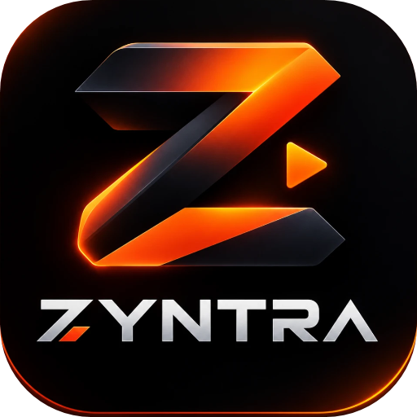

<p align="center">
  
</p>

<h1 align="center">Zyntra</h1>

<p align="center">
  <b>Todos tus juegos de PC en un solo lugar.</b><br>
  Launcher ligero y nativo para Windows: Steam, Epic Games, Xbox / PC Game Pass, Riot Games y tus propios juegos.
</p>

<p align="center">
  Creado por <a href="https://github.com/Zargch"><b>Zargch</b></a> · Código abierto (MIT) · Gratis, sin anuncios y sin telemetría
</p>

---

## ¿Qué es Zyntra?

Zyntra reúne en una sola biblioteca los juegos que ya tienes instalados en tus distintas tiendas. Muestra carátulas,
descripciones, capturas, reseñas y un clip de gameplay de cada uno, y los abre con un clic.
No reemplaza a Steam, Epic ni a la app de Xbox: Zyntra encuentra tus juegos y los abre con el lanzador oficial
de cada tienda, así que tus compras, partidas guardadas, logros y antitrampas siguen funcionando como siempre.

## Funciones

- **Detección automática** de juegos de Steam, Epic Games, Xbox / PC Game Pass y Riot Games. Con **+** añades cualquier otro juego o acceso directo.
- **Biblioteca viva:** los juegos que instalas o desinstalas aparecen y desaparecen solos.
- **Ordenados por el último que jugaste**, con filtros por tienda y buscador.
- **Carrusel destacado** con tus juegos recientes, su captura de fondo y un clip de gameplay en silencio.
- **Ficha a pantalla completa:** carátula, video, descripción, reputación (reseñas de Steam o estrellas de Microsoft Store) y galería de capturas.
- **Panel lateral:** botones Jugar, Abrir carpeta y Ver en la tienda. En **Más** puedes cambiar la carátula, elegir tu propio video, renombrar, ocultar o desinstalar (con confirmación).
- **Animación de inicio** con el logo (se salta con clic o Esc).
- **Muy ligero:** unos 60 MB de RAM en reposo y 0 % de CPU en segundo plano. Al minimizarlo libera los videos y las imágenes.

## Descarga e instalación

> Por ahora el repositorio es privado. Cuando se publique, las descargas estarán en **[Releases](../../releases)**.

1. Descarga **`Zyntra-Setup-x.y.z.exe`**. Es un solo instalador que sirve para Windows de 64 y de 32 bits y elige la versión correcta solo.
2. Ábrelo y sigue el asistente. No pide permisos de administrador: por defecto se instala solo para tu usuario.
3. Abre **Zyntra** desde el menú Inicio o el escritorio.

¿Prefieres no instalar nada? Descarga `Zyntra-x.y.z-portable-x64.zip` (o `-x86.zip`), descomprímelo y ejecuta `Zyntra.exe`.

### Verificar la descarga

Cada versión incluye `SHA256SUMS.txt`. En PowerShell:

```powershell
Get-FileHash .\Zyntra-Setup-1.0.0.exe -Algorithm SHA256
```

El resultado debe coincidir con la línea de ese archivo en `SHA256SUMS.txt`.

### «Windows protegió su PC» (SmartScreen)

Zyntra todavía no tiene firma digital, que es un certificado pago. Por eso, en las primeras descargas Windows puede mostrar
ese aviso. Haz clic en **Más información → Ejecutar de todas formas**. El código fuente está aquí completo y cada
versión se compila de forma pública en GitHub Actions a partir de él. Ver [SECURITY.md](SECURITY.md).

## Requisitos

| | |
|---|---|
| Sistema | Windows 10 versión 1809 o posterior, o Windows 11 |
| Arquitectura | x64 (64 bits) o x86 (32 bits). En ARM64 funciona con la emulación de Windows |
| Memoria | ~60 MB de RAM |
| Disco | ~10 MB para el programa, más la caché de imágenes y videos (unos 2–5 MB por juego) |
| Internet | Opcional. Solo hace falta para descargar carátulas, información y videos |

**macOS y Linux:** previstos. Zyntra usa APIs nativas de Windows, así que necesita un port propio. Ver [Hoja de ruta](#hoja-de-ruta).

## Uso rápido

| Acción | Cómo |
|---|---|
| Jugar | Selecciona un juego y pulsa **Jugar** (o haz doble clic en la carátula) |
| Ver ficha completa | **Ver ficha** en el carrusel. Rueda o flechas para cambiar de sección, **Esc** para cerrar |
| Añadir un juego | Botón **+**, elige su `.exe` o acceso directo |
| Volver a buscar carátulas y videos | **Actualizar** |
| Cambiar carátula o video | Panel lateral → **Más** → *Cambiar carátula…* o *Elegir video…* |
| Acerca de y créditos | Clic en el logo de Zyntra, arriba a la izquierda |
| Saltar la intro | Clic, Esc, Enter o Espacio |
| Desactivar la intro | En `%LOCALAPPDATA%\Zyntra\config.ini`, añade `[Zyntra]` y debajo `intro=0` |

## Datos técnicos

| | |
|---|---|
| Lenguaje | C++17, nativo Win32, sin frameworks ni dependencias externas |
| Interfaz | Direct2D 1.1 (render por software, sin cargar el driver de la GPU) y DirectWrite |
| Imágenes | Windows Imaging Component (WIC) |
| Video | Media Foundation: clips HLS armados en MP4 de ~24 s a 480p; la intro usa MFPlay |
| Red | WinHTTP, solo HTTPS |
| Detección | Steam: `libraryfolders.vdf` y `appmanifest_*.acf`. Epic: manifiestos de `ProgramData`. Xbox: `.GamingRoot` y el registro de GamingServices. Riot: `RiotClientInstalls.json` |
| Orden por uso | Registro `UserAssist` de Windows y su propio registro de partidas |
| Fuentes de datos | API pública de la tienda de Steam, SteamSpy y el catálogo de Microsoft Store |
| Datos locales | `%LOCALAPPDATA%\Zyntra\` (`config.ini`, caché `games\`, `crash.log`) |
| Binario | Un solo `.exe` de ~0,8 MB, CRT estático, ASLR, DEP y Control Flow Guard activados, sin empaquetadores |
| Instalador | Inno Setup 6, por usuario, sin pedir permisos de administrador |

### Estructura del repositorio

```
src/            código fuente (games.cpp es el launcher; intro.cpp la animación de inicio)
assets/         logo, icono e intro.mov
installer/      script del instalador (Inno Setup)
docs/           términos y condiciones, y política de privacidad
tools/          utilidades (make-icons.ps1 regenera los iconos a partir del logo)
.github/        compilación automática (GitHub Actions)
```

### Compilar desde el código

Necesitas Visual Studio 2019 o posterior con las herramientas de C++ (Build Tools basta).

```bat
build.bat          :: x64  -> bin\x64\Zyntra.exe
build.bat x86      :: 32 bits -> bin\x86\Zyntra.exe
build.bat all      :: ambas
```

Para armar el instalador en tu PC, instala [Inno Setup 6](https://jrsoftware.org/isinfo.php) y ejecuta `iscc installer\zyntra.iss`.
GitHub Actions lo hace solo en cada cambio ([build.yml](.github/workflows/build.yml)).

### Publicar una versión

1. Cambia la versión en `src/version.h` y anota los cambios en `CHANGELOG.md`.
2. Crea y sube la etiqueta: `git tag v1.0.1 && git push origin v1.0.1`.
3. GitHub Actions compila, arma el instalador y los ZIP portables, y crea un **borrador de Release** con las sumas SHA-256. Revísalo y publícalo.

## Privacidad

Zyntra **no recopila datos**: no tiene cuentas, anuncios, analítica ni telemetría. Solo consulta Steam, SteamSpy y
Microsoft Store para obtener información de tus juegos. Detalles en [PRIVACIDAD.txt](docs/PRIVACIDAD.txt).

## Legal

- Licencia: [MIT](LICENSE). Úsalo, modifícalo y redistribúyelo libremente, conservando el aviso `Copyright (c) 2026 Zargch`.
- [Términos y condiciones](docs/TERMINOS.txt) · [Política de privacidad](docs/PRIVACIDAD.txt) · [Créditos y marcas](NOTICE.md)
- Zyntra es un proyecto independiente, **no afiliado** a Valve, Epic Games, Microsoft ni Riot Games. Las marcas, carátulas y videos pertenecen a sus dueños.
- Zyntra no evita DRM, protecciones anticopia ni antitrampas, y no modifica ningún juego.

## Hoja de ruta

- [x] Windows x64 y x86
- [ ] Firma digital del ejecutable (SignPath para proyectos de código abierto)
- [ ] Interfaz en inglés
- [ ] macOS (Steam, Epic) y Linux (Steam, Heroic, Lutris): port con una capa gráfica multiplataforma

## Créditos

Creado y mantenido por **[Zargch](https://github.com/Zargch)**. Si haces un fork o una versión derivada,
conserva la licencia y menciona el proyecto original (ver [NOTICE.md](NOTICE.md)).
